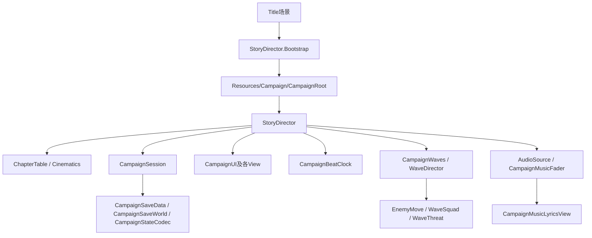

# 运行架构

## 启动与主要依赖

`StoryDirector` 是战役协调入口，跨场景存续。配置资产决定章节与分镜，敌人控制器执行移动/攻击，View呈现状态。当前仍使用Unity默认的运行时和编辑器程序集，目录按职责分组，不代表编译隔离。

## 主控部分文件

| 文件 | 职责 |
| --- | --- |
| StoryDirector.cs | Inspector配置、共享状态、启动、主循环与章节入口 |
| StoryDirector.Clock.cs | 拍点事件、计时同步和输入记录 |
| StoryDirector.Construction.cs | 建造输入判定、奖励及阶段结束 |
| StoryDirector.PreparationTransition.cs | 建造完成反馈、转场、持枪准备与防守接拍 |
| StoryDirector.Combat.cs | 防守输入、失败/挽救和章节结束；保留兼容的选择接口 |
| StoryDirector.Presentation.cs | 图片、Timeline、场景加载、报幕与HUD |
| StoryDirector.Endings.cs | 两种结局画面、结尾选项、制作人员和返回标题 |
| StoryDirector.Music.cs / ChapterMusic.cs | 播放控制、章节选曲、音乐身份与暂停判断 |
| StoryDirector.OpeningPictures.cs | 开场图片时长分配 |
| StoryDirector.MusicLyrics.cs | 歌词可见条件，与已有剧情字幕/制作人员避让 |
| StoryDirector.Persistence.cs | 存档捕获、场景/世界/时钟/音乐恢复 |
| StoryDirector.Debug.cs | 调试入口 |
| StoryDirector.Mechanics.cs | 机制介绍入口 |

这些文件属于同一个 `StoryDirector` 类型，共享原有字段与序列化身份。没有新增服务层或修改游戏状态机。

## 场景与章节

| 场景ID | 文件 | 用途 |
| --- | --- | --- |
| Title | Assets/Scenes/Title.unity | 主菜单入口 |
| 1 | Assets/Scenes/1.unity | 建造/修补及兼容流程 |
| 2 | Assets/Scenes/2.unity | 三轨防守 |
| 3 | Assets/Scenes/3.unity | 酒馆UI与Timeline制作场景 |

`CampaignSceneNames` 为代码提供具名常量；数字场景ID仍保留，旧存档中的场景名无需迁移。章节由ChapterTable决定，一章不等于一个Unity场景。

## 战斗与受击

`CapsuleTrack` 广播攻击轨道；`SBullet.CurrentTarget` 与开火共用筛选；`TargetMarker` 呈现同一目标。换轨只平滑移动准星，人物不跟随换轨。

`EnemyHP.TakeDamage` 进入受击/死亡反应。`CampaignReactionVisual.IsHitPlaying` 供普通移动、小队移动和定时移动共同查询；受击期间停步，结束恢复。WaveThreat顺延受击期间的到达时刻，避免抢跑结算或赶路加速。

## 音乐、分镜与字幕

章节配乐引用保存在ChapterTable。第1/2章连续使用同曲，第3–8章使用各自开场音乐，第9章保留静音；终章使用独立结局音乐。希望结局从进入时起播放连续录音，`hopeFinaleCueSeconds` 对齐门外镜头。制作人员表叠在虚化末图上。

歌词配置为Resources/Campaign/MusicLyrics.json。字幕读取实际AudioSource游标，角色名为英文，Gavroche仅第4章标注。战斗、命名、已有叙事字幕、制作人员表期间不叠加歌词。

## 状态与存档

RunState保存跨章进度；CampaignSaveWorld重建敌人/弹道等运行时对象；CampaignStateCodec恢复指定字段；StoryDirector.Persistence恢复时钟、画面和音乐进度。本次没有改类型名、字段名、程序集、存档格式或配置指纹算法。
